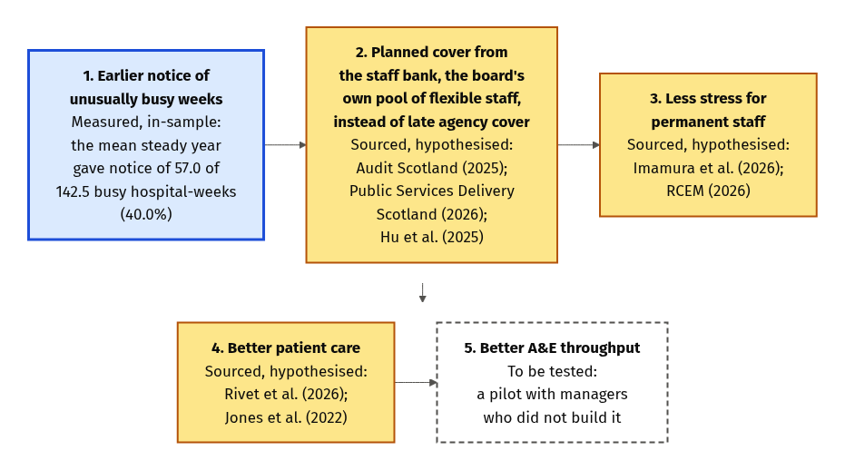
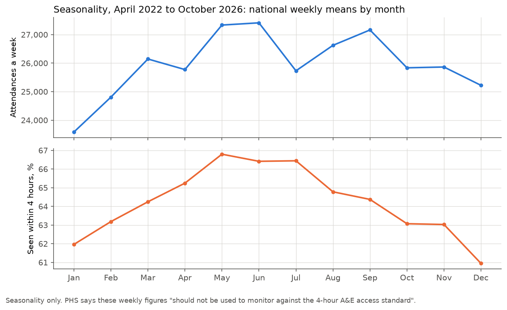
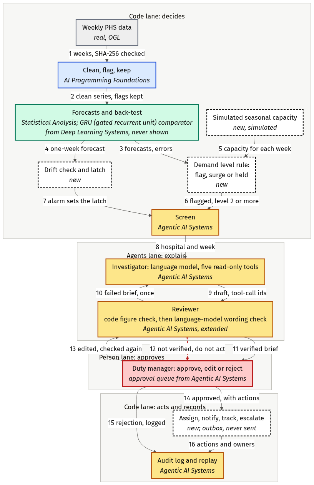
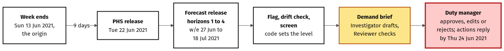
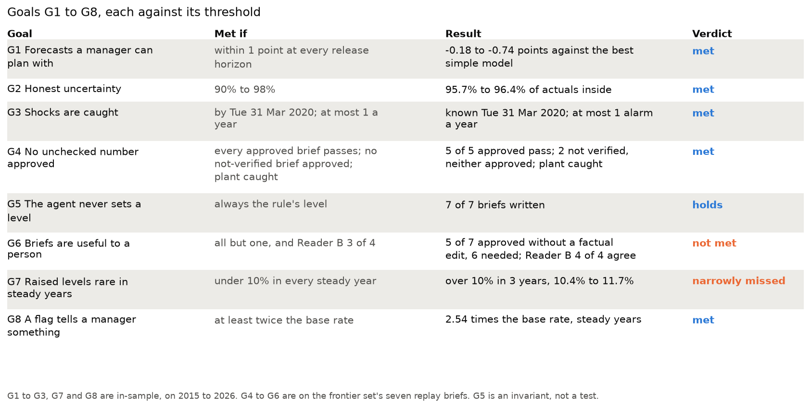
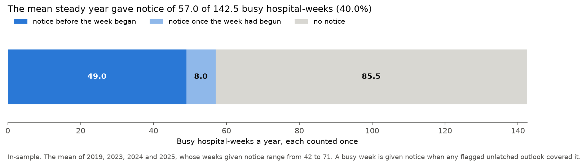
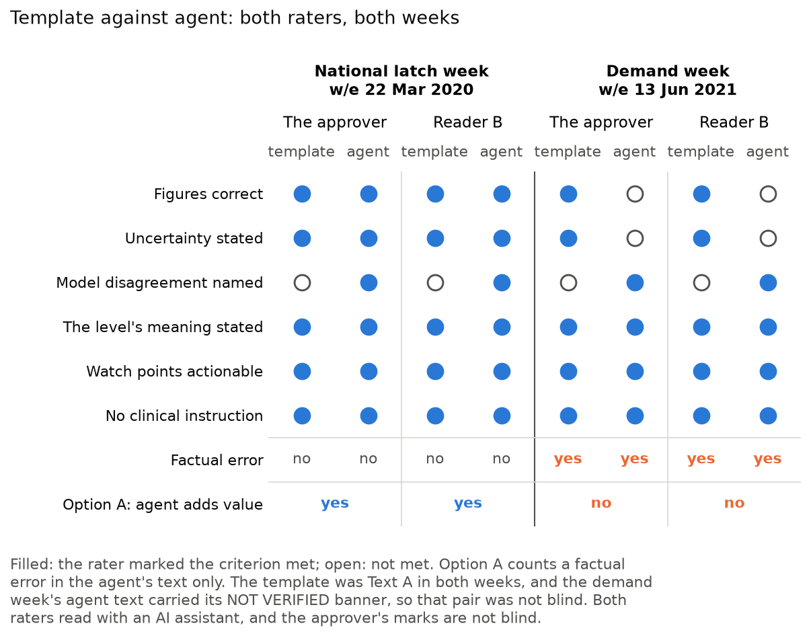

# Weekly A&E demand and escalation briefing: design case study

Patrick Gilliland, 26 October 2026

Every figure in this case study comes from the spot-check notebook, `ae_escalation_spot_check.ipynb`, or
from a source in the reference list. The notebook's figures are in-sample: the design was tuned on the
same 2015 to 2026 data that scores it.

**Terms.** A week is busy when its attendances reach 1.05 times its simulated capacity, and extra patients
are attendances above simulated capacity in busy weeks. An outlook is one hospital's four weeks ahead at
one origin; a hospital-week counted once is one hospital's one week, however many outlooks covered it.
The drift alarm fires when a series' actual attendances fall outside the range its forecast expected for
two released weeks running. Once it fires, the drift latch stays set, like an alarm that stays on until
someone resets it. While it is set, the forecasts are marked untrusted, and only a person can reset it.
The steady years are 2018 from July, 2019 and 2023 to 2026, and the mean steady year is the mean of
2019, 2023, 2024 and 2025. Each figure caption gives the figure's number in the notebook, which its file
name in `figures/` carries.

## 1. Overview

Industry: healthcare operations, unplanned attendances at Scotland's emergency departments, for the duty
managers who staff the front door.

**Status: additional information only.** At this stage the system gives the duty manager additional
information beside their existing process. It replaces no current process and sets no staffing on its
own. Becoming a primary operational tool needs shadow mode, a pilot and tuning over time, which is
achievable but not yet done (section 14).

**The problem.** Emergency department rotas are set weeks ahead. In England the rota code expects resident
doctors in training to get duty rosters at least 6 weeks before a new rotation starts (NHS England,
2025). So when a week turns out unusually busy, the front door is staffed for the usual week. Scottish
guidance says emergency department crowding "is linked to increased morbidity and mortality" (Scottish
Government, 2016). A forecast one to four weeks ahead can still inform short-notice changes inside a rota
already issued: extra shifts, bank staff or holding leave.

**The users.** A health board's duty managers, who staff the front door, and its unscheduled-care lead,
who owns the thresholds and approves each latch reset.

**The demand level, in one sentence.** The demand level shows demand unusually high for the time of year;
it is not pressure, need or priority.

**What is real and what is simulated.**

| Input | Real or simulated |
|---|---|
| Weekly unplanned attendances per hospital, and their national sum, from Public Health Scotland (PHS, 2026a) | Real |
| Attendances within 4 hours and waits over 12 hours, used only for the month chart and the pressure match | Real |
| Scottish bank holidays, GOV.UK's bank-holidays JSON | Real |
| The seasonal capacity the level is measured against | Simulated: a demand percentile, not beds or staff |
| The bands, 1.05, 1.10 and 1.15 times capacity | Our design, illustrative |
| The staffing actions by level, their owners and reply deadlines | Our design, illustrative |
| Staff acknowledgements of notifications | Simulated and seeded |
| Latch resets | Simulated: recorded at each review prompt |
| The language model's replies | Recorded live, replayed exactly in the notebook |

### The value chain

*Figure 1 (notebook Figure 2). The value chain: measured, sourced, to be tested.* Source: `diagram/value_chain.mmd`.

| # | Link | Label | Evidence |
|---|---|---|---|
| 1 | Earlier notice of unusually busy weeks | Measured, in-sample | The mean steady year gave notice of 57.0 of 142.5 busy hospital-weeks (40.0%). Over the steady years combined, 280 of 713 busy hospital-weeks had notice, carrying 19,806 of 46,243 extra patients; 197 had it from the week's own flag |
| 2 | Planned bank cover instead of late agency cover | Sourced, hypothesised | Audit Scotland (2025, p. 15), 2024/25: £256m on agency staff of all kinds (£57m nursing, £108m medical) and, separately, £353m on the nursing bank. Public Services Delivery Scotland (2026), 2025/26: agency nursing and midwifery £34.5m (down 39.2%), nursing and midwifery bank £391.0m (up 10.6%) on hours up 0.1%. Hu et al. (2025): one US emergency department's forecast-driven nurse staffing cut hourly staffing costs by $162.04 with no loss of throughput, before and after, with no control group |
| 3 | Less stress for permanent staff | Sourced, hypothesised | Imamura et al. (2026): a few studies of burnout and turnover suggest potential benefits of adequate staffing. Royal College of Emergency Medicine (RCEM, 2026): in its December 2025 survey one Scottish emergency department clinical lead reported decision fatigue and burnout among staff, and RCEM links crowding to burnout; the survey does not give its response count |
| 4 | Better patient care | Sourced, hypothesised | Rivet et al. (2026): more nurses per patient associated with lower emergency department mortality (adjusted odds ratio 0.68, 0.49 to 0.94), observational. Jones et al. (2022): delays to admission associated with 30-day mortality. RCEM (2026) estimates 818 deaths in Scotland in 2025 associated with long waits: an estimate, not a count |
| 5 | Better A&E throughput | To be tested | The pilot's goal (section 14) |

Link 1 is measured, in-sample. Links 2 to 4 are benefits the sources support, and link 5 is a hypothesis
a pilot would test. None is an effect this system has shown.

**The scale.** In 2024/25 Scotland spent £256m on agency staff of all kinds and, separately, £353m on the
nursing bank, about £0.6bn together (Audit Scotland, 2025). Scotland's A&E sites, minor
injury units included, saw 137,703 attendances a month in 2025, about 1.65m in the year (Public Health
Scotland, 2026b). The weekly data holds 1,405,613 attendances at the 30 emergency departments for weeks
ending in 2025, my sum in the notebook (Public Health Scotland, 2026a). At that scale a small improvement
is material.

**The caution.** The money saving would be mainly the agency premium, agency hours moved to planned
bank hours, not the whole supplementary spend, and the agency figure covers every specialty, not only
A&E. The wider value lies in links 3 and 4 of the value chain, less stress for permanent staff and
better patient care, which are sourced and hypothesised, not measured here. Figures on lives or harm
remain the stakes, never claims.

**The wider system.** The data holds attendances, which run highest in May and June, while the share seen
within 4 hours is lowest in December and January, and waits over 12 hours peak in January (Figure 2). It
holds no beds, so uses for beds and social care need admissions and occupancy data (section 14).

*Figure 2 (notebook Figure 4). Monthly attendances against 4-hour performance.* Seasonality only: Public Health Scotland says
these weekly figures should not be used to monitor against the 4-hour A&E access standard.

## 2. Architecture

*Figure 3 (notebook Figure 1). Code decides, the agents explain, a person approves.* Source: `diagram/architecture.mmd`.

The design has three lanes. **Code decides**: it loads the data, forecasts, sets the demand level, checks
for drift, screens which hospitals reach the agents, and then acts and records. **The agents explain**: an
Investigator drafts each demand brief from read-only tools, and a Reviewer checks it. **A person
approves**: the duty manager approves, edits or rejects each brief. The screen is code, so it sits in the
code lane.

Each box names the prior project it comes from, or says it is new in this project:

- **Weekly PHS data**: real, under the Open Government Licence.
- **Clean, flag, keep**: AI Programming Foundations.
- **Forecasts and back-test**: Conduct a Statistical Analysis Using Python ("Statistical Analysis" below),
  with a comparator from Deep Learning Systems, a recurrent network, a GRU (gated recurrent unit), never
  shown to a manager.
- **Simulated seasonal capacity, the demand level rule, the drift check and latch, and the coordinator**:
  new in this project.
- **The screen, the Investigator, the Reviewer, the approval queue, and the audit log and replay**:
  Agentic AI Systems, the Reviewer extended with a wording check.

Each arrow carries a number, which is its row in the interaction table in section 3.

## 3. Data flow and orchestration

**The weekly flow, in nine steps.**

1. **Weekly load.** Code reads the Public Health Scotland file, checks its SHA-256, cleans it and flags
   anomalies, keeping every row. It uses only the weeks released by the forecast origin.
2. **Forecast.** Seasonal naive, the 4-week moving average, a linear model and SA-MA, the 4-week moving
   average with a seasonal index, forecast the four
   week-endings after the release, each with an 80% and a 95% range. One primary model drives the flag.
   It starts as linear and is re-selected among the four at each latch reset. A GRU runs beside them as a
   comparator.
3. **Flag and drift.** From the primary's last 104 released errors, code works out each week's chance of
   reaching 1.05 times its simulated capacity, and flags an outlook when one week's chance is at least
   50%. The drift alarm fires when actuals fall outside the drift interval two released weeks running, and
   sets the drift latch.
4. **Screen.** Code sends on only a hospital that is flagged, or latched, which covers a surge or held
   level of 2 or more. Nothing else reaches the agents.
5. **Investigator.** It drafts the demand brief through five read-only tools: forecast, history,
   back-test error, track record and calendar. Code writes every figure with a label saying what it is,
   and the level is always the rule's.
6. **Reviewer.** Code checks every figure against its tool result and the level against the rule. A
   language model then checks the wording: no claim of cause without a tool basis, no figure described as
   something its label says it is not, and nothing that reads as an instruction to a clinician.
7. **Approval.** The duty manager approves, edits or rejects, with initials, a time and the six approval
   criteria.
8. **Coordinate.** Code sets the staffing actions for the level, assigns each an owner and a reply
   deadline, tracks it and escalates it. The language model drafts only each notification's wording.
9. **Audit.** Every tool call, draft, check and decision is logged with the backend that wrote it, and
   every model call is recorded, so the notebook replays the run exactly.

**The Tuesday release and the four release horizons.** Each week is published on the Tuesday, 9 days
after its week ends. A forecast origin is the latest released week. The four release horizons are the four
week-endings after the release: for the origin w/e 22 Mar 2020, released on Tue 31 Mar 2020, they are the
weeks ending 5, 12, 19 and 26 Apr 2020, data horizons 2 to 5.

*Figure 4 (notebook Figure 3). One week: Tuesday release to the duty manager's decision.* Source: `diagram/weekly_cycle.mmd`. The dates
illustrate the release timing for one replay week, Ninewells Hospital's demand week ending 13 Jun 2021;
that week's brief was rejected.

**The approval routes.**

- A verified brief reaches the duty manager, who approves, edits or rejects it.
- A brief that fails a check goes back to the Investigator once, with every problem named. A brief that
  fails again reaches the manager marked "not verified, do not act", and can never be approved.
- An edit is checked again: the code figure check, the screen for the words the Medicines and
  Healthcare products Regulatory Agency (MHRA) lists as indicative of a medical device, and the Reviewer's wording check. An edit that fails comes back to the
  manager marked "not verified, do not act", never to the Investigator.
- A rejection is logged, and nothing is sent.

**The coordinator's state machine.** Level 1 sets no staffing action. At level 2, code sets two actions:
check whether extra shifts or bank staff are needed, owned by the duty manager, and hold new leave
requests, owned by the rota coordinator. Level 3 adds a request to the staff bank, and level 4 tells the
unscheduled-care lead. Each action is notified; if its reply deadline passes without an acknowledgement, it
is escalated to the role above, and a later acknowledgement is recorded as late. A notification that fails its figure check twice is held, and
the manager sees it with its failing figures marked. The action's text is code's; the language model
drafts the notification's wording, which states only figures the approved brief states.

**The interaction table**, one row for each numbered arrow in Figure 3.

| # | From | To | What passes |
|---|---|---|---|
| 1 | Weekly PHS data | Clean, flag, keep | The weeks released by the origin, after the SHA-256 check |
| 2 | Clean, flag, keep | Forecast | The clean series per hospital and nationally, with its flags kept |
| 3 | Forecast | Demand level rule | The primary model's forecasts for the four release horizons, and its released errors, which give the flag's chance |
| 4 | Forecast | Drift check | The primary model's one-week-ahead forecast |
| 5 | Simulated seasonal capacity | Demand level rule | The capacity for each target week |
| 6 | Demand level rule | Screen | Hospitals flagged, or at a surge or held level of 2 or above, with the level's source |
| 7 | Drift check | Screen | The alarm, which sets the drift latch |
| 8 | Screen | Investigator | Each screened hospital and week; nothing else reaches the agents |
| 9 | Investigator | Reviewer | The draft demand brief, with each cited figure's tool-call id |
| 10 | Reviewer | Investigator | A failed brief, once, with the failing figures or wording named |
| 11 | Reviewer | Manager | A verified brief |
| 12 | Reviewer | Manager | A brief that failed twice, or an edit that failed, marked "not verified, do not act", failing figures marked |
| 13 | Manager | Reviewer | An edited brief, which the checks run again |
| 14 | Manager | Assign, notify, track, escalate | An approved, verified brief and the level's staffing actions |
| 15 | Manager | Audit log and replay | A rejection, logged; nothing is sent |
| 16 | Assign, notify, track, escalate | Audit log and replay | The actions, owners, outbox notifications and acknowledgements |

## 4. Assumptions

Items 1 to 7 are assumed, each with where it comes from; item 8 says how the spot check was run.

1. **Simulated capacity.** Assumed, our design: for each target week, the 90th percentile of the
   hospital's weekly unplanned attendances in the same 13-week window, centred on that week, in each of
   the previous three years, released weeks only. The open data holds no beds or staffing.
2. **The bands, 1.05, 1.10 and 1.15 times capacity.** Assumed, our design, on the structure of England's
   Operational Pressures Escalation Levels (OPEL) framework, where a score sets the level and people decide the actions, not its scale (NHS England,
   2024).
3. **The flag's setting, a week's chance of at least 50%.** Assumed, chosen in the design probes by a
   rule stated before their results, on the same data: in-sample.
4. **The staffing actions by level and their owners.** Assumed, on the structure of OPEL's actions by
   level, each with an owner, not its actions (NHS England, 2024).
5. **The reply deadlines.** Assumed: 48 hours at level 2, 24 at level 3 and 12 at level 4, from 10:00 UK
   time on release day.
6. **The acknowledgements.** Assumed, simulated and seeded: three in four actions are acknowledged, after
   2 to 72 hours.
7. **Latch resets.** Assumed: recorded at each review prompt after 8 clear weeks. In use the
   unscheduled-care lead approves each one.
8. **My three roles in the spot check.** I play the approver, the unscheduled-care lead and the
   analytics lead; the latch resets and re-selections in the replay are recorded by code at each prompt.
   The clinical safety reviewer's sign-off is not exercised, because there is no live use.

## 5. Tradeoffs

**Technical: a simple primary against the GRU.** The primary is one of four simple models, re-selected
at each latch reset. The GRU runs as a comparator only. Outside each series' drift episodes, the window
that G1, forecasts a manager can plan with, scores, no release horizon of the five replay series had a paired interval favouring the GRU, and 16
of the 20 favoured the primary. Outside March 2020 to March 2022, the data test's window, one did: the
Queen Elizabeth at release horizon 4, by 0.56 points (0.06 to 1.01). As I stated before the run, the GRU
stays a comparator for operational reasons.
The gain from the simple primary is a forecast a manager can check in one sentence, with no yearly refit
and no seeds to average. The cost is a forecast that cannot learn patterns the four simple models miss.

**Data: simulated capacity against no capacity at all.** With no beds or staffing in the open
data, the level needs a line to measure demand against, so I simulate one from past demand. The gain is a
level that can be tested on real attendances; the cost is a level that is illustrative, not a statement
about beds. The sensitivity table shows what the setting changes: in the steady years, 22.2% of unlatched
outlooks are flagged at the 80th percentile, 9.6% at the 90th and 4.8% at the 95th.

**Operational: rarity against recall.** The flag fires on 9.5% of the steady-year outlooks whose weeks
are known, and 53.8% of those flags are borne out, against 21.2% of outlooks without one. The sensitivity
table above counts every unlatched outlook, so its rate at the 90th percentile is 9.6%. But the flag
catches only 21.0% of the busy outlooks. Fewer flags are borne out more often, but most busy outlooks get
no flag.

**Code decides, the agents explain, a person approves.** Rules set every number and level, so
they are repeatable and checkable. The language model adds explanation only, and every brief costs model
calls and a person's time.

**The model backend.** The local model runs on this machine, costs nothing per call and is pinned by
digest. It verified none in either round. In round 1 each retry went out blind, a bug in my client that
round 2 fixed, and the time budget stopped the run after 3 of the 7. In round 2 every draft reached the
8,192-token output cap, which counts the model's thinking; a retry with thinking turned off is untried
and is a next step (section 14). The frontier model verified 5 of 7, short of the adequacy test's 6:
the checks refused both demand briefs for claims no tool result supports, and closing that gap comes
before shadow mode (section 14). Its set is the one approved, at the cost of money, an outside service
and a model that cannot be pinned the same way.

## 6. Constraints

1. **Rotas are set ahead.** Rosters reach resident doctors weeks before a rotation (NHS England, 2025),
   and rota guidance describes shifts known months in advance (Royal College of Emergency Medicine, 2019).
   Neither source is Scottish. *Shaped*: the four release horizons and front-door staffing actions only.
2. **The publication lag.** Each Tuesday release covers the week that ended 9 days earlier. *Shaped*: the
   horizons count from the release.
3. **No beds, staffing or occupancy in the open data.** *Shaped*: the capacity is simulated and the levels
   illustrative.
4. **Demand is not pressure.** Attendances run highest in May and June, while 4-hour performance is worst
   in December and January (Figure 2). *Shaped*: the level is a demand level, never called
   pressure.
5. **Shocks such as COVID break every model.** *Shaped*: the drift latch, the surge rule and the
   re-selection at each latch reset.
6. **Escalation in Scotland.** The 2016 guidance sets three stages, triggered by hours after a patient is
   ready to move, department occupancy and ambulance delays (Scottish Government, 2016), none of them
   attendances, so a forecast of attendances cannot set a stage.
   The October 2026 surge framework says "No single indicator should determine escalation decisions in
   isolation" (Scottish Government, 2026). The Scottish Government committed to an NHS Scotland OPEL
   system in June 2025 (Scottish Government, 2025, recommendation 33). *Shaped*: the bands borrow only the
   structure of England's OPEL framework, and the level never sets an escalation stage.
7. **Runtime and tools.** `config.json`'s `llm_backend` is `frontier`: the frontier set is the one
   approved, and the recordings make the notebook reproducible on either setting. Setting it to
   `local` selects the local model. The local model did not write adequate briefs in either round, its
   retries blind in round 1 and its drafts cut at the output cap in round 2, so the frontier model ran
   once, as ruled before the runs. It verified 5 of 7, short of the adequacy test's 6, as the checks
   refused both demand briefs, and the approver chose its set on those facts. The local model stays an
   option to retest with its thinking turned off. Each GPU run
   was meant to stay under 15 minutes. Round 1 stopped at its 840-second budget; for round 2 I allowed up
   to 60 minutes and set a 30-minute budget, and it used 657 seconds after a 95-second model load. Only
   tools from the prior projects are used, with one ruled exception: the switch to a frontier model with
   a stated case. *Shaped*: the bounded replay set, the local model and the backend switch.
8. **Time.** The aim was to submit within a week, with quality before the date. *Shaped*: a tight build,
   with shadow mode on new releases stated as a pre-deployment step.

## 7. Risks

| # | Risk | Effect | Control | Owner |
|---|---|---|---|---|
| 1 | The front door is staffed for the usual week when demand is not usual (Scottish Government, 2016) | Harm from crowding; waits also depend on beds and flow, which the system does not see | Earlier notice of unusual demand beside the manager's usual information; the level's meaning on every brief | Duty manager |
| 2 | A shock breaks every forecast: the linear model's national forecast made at w/e 8 Mar 2020 missed by 152.8% three weeks later | Levels and briefs built on broken forecasts | The drift latch; the surge rule; forecasts marked untrusted; re-selection at each latch reset | Unscheduled-care lead (reset); analytics lead (re-selection) |
| 3 | False flags and alert fatigue: the mean steady year raised 145 outlook flags, 66 of them not borne out. September's flags were borne out 40.4% of the time, against 14.9% for unflagged September outlooks | Staff time spent for nothing; briefs ignored | Approval of every brief; the hospital's track record on every brief; the sensitivity table; the flag reported by month | Unscheduled-care lead (thresholds) |
| 4 | A missed busy week: the flag caught 21.0% of busy outlooks in the steady years, and the mean steady year left 85.5 of 142.5 busy hospital-weeks with no notice | No extra notice of an unusual week, so staffing rests on the existing process alone | The range and the hospital's own error on every brief; recall and notice reported; learning what planners use (section 14) | Unscheduled-care lead |
| 5 | Bias by hospital size: seasonal naive's median error is 11.0% at sites under 300 attendances a week and 5.4% at 1,300 and over. The raised share varies widely by site: the five most raised, two children's hospitals and three hospitals under 800 attendances a week, raised 35.7% to 18.8% of their outlooks, while among the largest adult departments the Queen Elizabeth raised 16.6%, Edinburgh 4.7% and Glasgow Royal Infirmary none | Attention spread unevenly, by noise at small sites and not by need | Each brief shows its own site's error and track record; the level is never read as need or priority; the level reported by site | Unscheduled-care lead |
| 6 | Misuse as a league table, a case for cuts, or 4-hour monitoring | Harm to the hospitals the size bias already burdens | The stated purpose on every brief, the README and the notebook | Unscheduled-care lead |
| 7 | Classification as a medical device (Medicines and Healthcare products Regulatory Agency, 2023) | Regulatory duties the design does not meet | Aggregate planning only; a code screen for the MHRA's indicative words; advisory status; my reading kept as an open risk | Clinical safety reviewer |
| 8 | An invented or misattached figure | A manager misled by a wrong number or date beside their usual information | The code figure check on every brief, edit and notification; a "not verified" brief never approved; a planted figure caught in the test | Analytics lead (the check); duty manager (approval) |
| 9 | Automation bias (Goddard et al., 2012) | A manager approves without reading, or weighs a brief above their usual information | Ranges, disagreement and the track record shown; six approval criteria; a second reader in the evaluation | Duty manager |
| 10 | In-sample design tuning | Figures better than a new period would give | The notebook re-measures every figure; shadow mode on new releases before any go-live | Analytics lead |
| 11 | The flag's stated chance runs high: in the steady years each week's own chance averaged 0.162, and 8.9% of those weeks were busy | A manager reads a flag as surer than it is | The brief quotes the hospital's track record, never the chance | Analytics lead |
| 12 | The local model writes briefs too weak to approve | Nothing usable reaches approval, or weak briefs are approved | The adequacy test stated before any brief; one run of the frontier backend with a stated case; the Reviewer on either backend | Analytics lead |

## 8. Boundaries of capability and responsibility

**What the system does not do.** At this stage it gives the duty manager additional information
beside their existing process: it replaces no current process and sets no staffing on its own. It never
sets a level by judgement, never sends without approval, never
sees patient data and never quotes the flag's stated chance. It forecasts weeks, not days, and it does not
see beds, flow or 4-hour performance, so the level is never a measure of pressure. It is not for ranking
hospitals, justifying cuts or monitoring the 4-hour standard.

**Where a person takes over.** The duty manager approves, edits or rejects every brief, and only an
approved, verified brief leads to staffing actions, each assigned to a person who decides what to do. While the drift latch is set the forecasts are untrusted, and only
a person approves a latch reset. People acknowledge each action, and a missed deadline goes to the role
above. The design follows the principle that a person can disregard, override or reverse the output
(European Union, 2024, Article 14), as a principle, not a legal duty.

**Owners by role.**

| Role | Owns |
|---|---|
| Duty manager | Each brief's decision, and the check on extra shifts and bank staff |
| Unscheduled-care lead | The thresholds and the bands; approval of each latch reset |
| Analytics lead | The re-selection of the primary model at each reset, and any other model change |
| Clinical safety reviewer | Sign-off before any live use |

In the spot check I play the approver, the unscheduled-care lead and the analytics lead. The clinical
safety reviewer's sign-off is not exercised, because there is no live use. Approving briefs for a system I
built is a limitation, which a second reader, Reader B, a person, who read with an AI assistant,
checks: Reader B made the same decision as the approver on all four briefs.

An AI independent judge read the seven briefs before I decided. I adopted its five edits as my own, with
the reset wording corrected, and its notes on the two rejections, as each decision's note records. An AI
reviewer, not the system's Reviewer, scored the adequacy test, so my approval stayed separate from it.

## 9. Reuse register

Each pattern is adapted for this project, never copied in as a file, and each module names the pattern it
reuses in a comment. Each repository is at github.com/PaddyGilliland1, and cell numbers count from 0.

| Project | Repository | File: function or cell | Commit | Component here |
|---|---|---|---|---|
| AI Programming Foundations | ai-programming-foundations-project | `data_workflow.ipynb`: `standardise_columns` (cell 9), `flag_unexplained_payments` (cell 27) | `dc8dabd` | Load, clean, flag and keep (`data.py`) |
| Conduct a Statistical Analysis Using Python | statistical-analysis-project | `analysis.ipynb`: `mean_with_ci` (cell 47), the trend line with `linregress` (cell 101), `bootstrap_slope` (cell 104), `paired_t_test` (cell 122) | `7556623` | The flag's and the drift interval's spread of past errors, the linear model's trend, the moving-block bootstrap and the paired comparison (`rules.py`, `backtest.py`, `forecasts.py`) |
| Deep Learning Systems | deep-learning-systems-project | `deep_learning.ipynb`: `naive_forecasts` (cell 24), `ForecastRNN` with `cell="gru"` (cell 56), `predict` (cell 61) | `5511b2b` | The simple bars to beat and the GRU comparator (`forecasts.py`, `gru.py`) |
| Agentic AI Systems | agentic-ai-systems-project | `agentic_system.py`: `screen`, `Toolbox` with `verify_figures`, `ModelGateway` with `RecordingStore`, `approval_queue`, `AuditLog`, the case file and the manifest check | `d110982` | The screen, the typed read-only tools, the Investigator's tool loop, the Reviewer's figure check, record and replay, the approval queue, the audit log and the data manifest check (`tools.py`, `briefs.py`, `agents.py`, `figures.py`, `gateway.py`, `approval.py`, `replay.py`, `data.py`) |

## 10. Method provenance

| Method | Prior project, or new | Published source |
|---|---|---|
| Load, clean, flag and keep | AI Programming Foundations | None needed |
| Confidence intervals and a seeded bootstrap; the paired comparison of two models | Statistical Analysis | None needed |
| The linear model: a trend line plus four sine and cosine pairs | The trend line from Statistical Analysis; the sine and cosine terms my own extension | Hyndman and Athanasopoulos (2021), section 7.4 |
| The rolling-origin back-test, scored by MAPE | Statistical Analysis, its time-based hold-out repeated every week | Hyndman and Athanasopoulos (2021), sections 5.10 and 5.8 |
| The moving-block bootstrap | Statistical Analysis, its bootstrap resampled in blocks | Hyndman and Athanasopoulos (2021), section 12.5; Kunsch (1989) |
| Seasonal naive and the moving average as bars to beat | Deep Learning Systems | Hyndman and Athanasopoulos (2021), section 5.2 |
| SA-MA, the moving average with a seasonal index | New in this project | Described as my own extension |
| The probability flag | New, on Statistical Analysis's interval from past values | Described as my own design |
| The GRU comparator | Deep Learning Systems | Petravić et al. (2025) review recurrent networks among emergency department forecasters |
| Re-selection of the primary by out-of-sample error | Statistical Analysis | Hyndman and Athanasopoulos (2021), section 5.10 |
| The drift interval, the alarm and the latch | The interval from Statistical Analysis; the two-week alarm and the latch new | Hyndman and Athanasopoulos (2021), section 5.5, for the interval's basis only |
| The screen | Agentic AI Systems | None needed |
| Agents with typed read-only tools, the approval queue, replay and the audit log | Agentic AI Systems | Yao et al. (2023) for tool use |
| The Reviewer: the code figure check, then the wording check | Agentic AI Systems' figure check, extended | Described as my own design |
| The frontier backend behind one configuration value | New, on Agentic AI Systems' model gateway | None needed |

**Built beyond the plan, new in this project:**

- a code screen for the words the MHRA lists as indicative of a medical device;
- the tool-call cap, and a time budget that holds for a whole run;
- the "Written by" line naming the backend and model on every brief;
- the scripted demonstrations of the safeguards;
- the self-labelling placeholders: code writes every figure and what it is, and the model's words name no
  number, model, week, hospital or level;
- the Reviewer's third check, that each sentence describes its figures as their labels say;
- one more try for a Reviewer whose call failed or whose verdict could not be read;
- "not verified" counted by cause;
- the commands that record the adequacy test and the approver's choice of set.

## 11. Scenarios

The replay set is five named series, the national series and four hospitals, at six origins. The expected
outcomes were written before any agent ran; the pre-run check found the same seven briefs.

| Origin (release) | Expected briefs | Observed, frontier set |
|---|---|---|
| w/e 6 Oct 2019 (Tue 15 Oct 2019) | 1: Royal Infirmary of Edinburgh, surge, its forecasts untrusted | Verified on the retry; approved with an edit. Its two notifications and one escalation reached the outbox, never sent |
| w/e 8 Dec 2019 (Tue 17 Dec 2019) | 0: the week before that winter's worst national 4-hour week, with no series flagged | No brief |
| w/e 15 Mar 2020 (Tue 24 Mar 2020) | 0: the first breach, with no alarm yet | No brief |
| w/e 22 Mar 2020 (Tue 31 Mar 2020) | 4: latch, for the national series, Edinburgh, Ninewells and the Queen Elizabeth; Lorn & Islands not latched | All four verified, one on the first attempt; each approved with an edit. Level 1, held, so no staffing action |
| w/e 13 Jun 2021 (Tue 22 Jun 2021) | 1: Ninewells, demand, flagged | Not verified: the code check refused the first draft, and the wording check refused the second for claims no tool result supports, such as recent weeks rising. It reached the approver marked "not verified, do not act" and was rejected; the fix comes before shadow mode (section 14). The designed failure, a second run of this brief with a figure planted by code in its first readable draft, was caught at that figure |
| w/e 9 Apr 2023 (Tue 18 Apr 2023) | 1: Lorn & Islands, demand, flagged | Not verified, as for Ninewells: its second draft said the forecasts fit recent weeks, which no tool result supports. Rejected, with the same next step |
| **Total** | **7**: 4 latch, 1 surge, 2 demand | 5 verified, approved with an edit; 2 rejected |

Neither local set verified a brief, so none of its briefs could be approved. Round 1 completed 3 of its
7 briefs before its 840-second budget stopped it, and the text rules refused both drafts of each: each
retry went out blind, a bug in my client that round 2 fixed. Round 2 completed all seven, and every
draft was cut at the 8,192-token output cap, which counts the model's thinking; a retry with thinking
turned off is untried (section 14).

**The template comparison** used two of these weeks: the national latch week, w/e 22 Mar 2020, and
Ninewells' demand week, w/e 13 Jun 2021. By option A, both raters found the agent's text added value
in the national latch week and not in the demand week, whose brief the checks had refused; section 13
gives the marks.

## 12. Plausibility notes

Each designed-only element, and what a live system would do instead.

- **The replay set.** Seven briefs from five series at six origins stand for the full screen, which at
  those origins would send 2, 4, 1, 12, 4 and 6 briefs across all 30 hospitals and the national series.
- **The GRU.** It runs on the five replay series here; in the design it would run per hospital, still as a
  comparator only.
- **Notifications.** They go to an outbox file and are never sent. A live system would send them through
  the board's own messaging, with the same check before each one.
- **Acknowledgements.** They are simulated and seeded. In use, people acknowledge each action.
- **Latch resets.** They are recorded at each review prompt. In use the unscheduled-care lead approves
  each one against documented reset criteria.
- **Capacity.** It is a demand percentile. A board would measure against its own staffed capacity.
- **The staffing actions.** Code fixes each action's text by level; the language model drafts only each
  notification's wording. A board would set its own actions and owners.
- **The roles.** I play three roles, and the clinical safety reviewer's sign-off is not exercised.
- **The template comparison.** Two raters marked two weeks, both with an AI assistant, and one of them
  is the approver, whose marks are not blind. A pilot would repeat it with managers who did not build
  the system (section 14).
- **Shadow mode.** The frozen design has not yet run on new weekly releases.

## 13. Evaluation summary and limits

*Figure 5 (notebook Figure 5). Goals G1 to G8, each against its threshold.*

**The goals.** Five goals are met, the invariant holds, G7 is narrowly missed in three growth years and
G6 is not met because the checks refused both demand briefs.

- G1, forecasts a manager can plan with, G2, honest uncertainty, G3, shocks are caught, and G8, a flag
  tells a manager something, are met, in-sample. The primary's national error is within 1 point of the best simple
  model at every release horizon, the best simple model being the better of seasonal naive and the
  4-week moving average at that horizon. Between 95.7% and 96.4% of national actuals fall inside its 95% range.
  The national drift alarm was known on Tue 31 Mar 2020. Outlook flags were borne out 2.54 times as often
  as the base rate in the steady years.
- G4, no unchecked number reaches a manager as approved, is met: all 5 approved briefs pass the code check again, neither brief that was not verified was
  approved, and the planted figure was caught. G5, the agent never sets a level, holds in all 7 briefs written.
- G6, briefs useful to a person, is not met: 5 of the 7 briefs were approved without a factual edit, where 6 are needed. The
  two short are the demand briefs, which the checks refused, so the approver could only reject them;
  none of the five edits was factual. Explaining a demand week without unsupported claims is the next
  step (section 14). Reader B, a person, who read with an AI assistant, made the same decision as
  the approver on all four briefs, so G6's second half is met.
- G7, raised levels rare in steady years, is narrowly missed, as ruled, and nothing was tuned: 10.4% of outlooks were raised in 2018 (from July),
  10.9% in 2023 and 11.7% in 2024, against under 10%. My reading, which the design probes did not test, is that in those
  growth years attendances ran above the three previous years that set the capacity. Shadow mode
  tests that reading on weeks the design has never seen, before any threshold moves (section 14).

**The headline, in its two units.** In the steady years, a flag means an unusually busy week is likely in
the next four: that held 53.8% of the time, against 21.2% without a flag. The exact week named was right
27.6% of the time, against 7.8% for a week without a flag.

**Notice, each hospital-week counted once.** The mean steady year gave notice of 57.0 of 142.5 busy
hospital-weeks (40.0%), 49.0 of them before the week began. Over the steady years, 280 of 713 busy
hospital-weeks had notice, carrying 19,806 of 46,243 extra patients; 197 had it from the week's own flag.

*Figure 6 (notebook Figure 6). Busy hospital-weeks given notice, the mean steady year.*

**Calibration.** Each week's own stated chance runs high: in the steady years it averaged 0.162, and 8.9%
of those weeks were busy. So the brief quotes the hospital's track record, never the chance. The flag
still beats each hospital's real-time busy share, with a Brier skill of 0.128.

**The September residue.** 12.8% of steady-year September outlooks are flagged, and 40.4% of those flags
are borne out, against 14.9% of unflagged September outlooks.

**Demand is not pressure.** In the steady years 29.9% of raised outlooks fell in their hospital's worst
quarter of 4-hour weeks for the year, against 25.4% by chance: a weak link.

**The template comparison.** Both raters marked each text of both pairs against the six criteria.
Reader B is a person, who read with an AI assistant. The approver's marks were also made with an AI
assistant, and they are not blind, since the approver had read every agent brief at approval. By
option A, the agent's text adds value in the national latch week for both raters: it names the
models' disagreement, which the template does not. In the demand week it does not, for both raters. That text is the refused demand
brief, so both marked its figures not correct, as it is marked not verified, its uncertainty not
stated and a factual error, for its claims that recent weeks were rising and the forecasts fit them.
The checks had already stopped that brief, and the fix comes before shadow mode (section 14). Both
raters also marked a factual error in the template's drift line. The demand week's pair is not blind,
and the template was Text A in both weeks.

*Figure 7 (notebook Figure 7). Template against agent: both raters, both weeks.*

**Failure cases.** COVID, real: the alarm confirms a shock and does not warn; the first breach was w/e 15
Mar 2020. The planted figure, designed: caught at that figure. The demand briefs, real: the Reviewer
refused both for claims no tool result supports, so neither could be approved; the fix comes before
shadow mode (section 14). The local backend: no brief verified in either round. Round 1's retries went
out blind, a bug that round 2 fixed, and its budget stopped it after 3 of 7; round 2's drafts all
reached the output cap, and thinking turned off is the untried next step.

**Limits.** The notebook's section 9 sets out twelve limitations, each with its evidence. In short:

1. the track-record line drops the unflagged busy share when a hospital has no past flag;
2. a back-test error sits beside "forecasts untrusted";
3. the Reviewer's reasons are noisy;
4. the local model was not tried with its thinking turned off;
5. explaining a demand week overreached;
6. the template's drift line rests on the drift rule alone;
7. the demand week's template pair is not blind;
8. the template comes first in both pairs;
9. a level-2 action holds leave while the forecasts are untrusted;
10. a range can join the ends of two weeks;
11. G6 is not met, as both demand briefs were refused and rejected, with the builder as approver;
12. round 1's retries went out blind.

Every figure here is in-sample.

## 14. Deployment path and next steps

These are future pre-deployment investigations after this base is proven, in order. Together they are
the path from additional information beside the duty manager's existing process to a primary
operational tool.

1. **Shadow mode before any go-live.** The frozen design runs on new weekly releases, every brief written
   and logged and none acted on, and the goals are scored on weeks the design has never seen. Before it
   starts, two gaps this build found need closing: explaining a demand week without claims the tools do
   not support, and the local model tried with its thinking turned off.
2. **Learn what planners use.** Ask the duty managers what they weigh beyond the tool, and measure which
    factors would have explained past busy weeks. Then route each one:

    - a model input, if it recurs with a measured history, tested on the back-test;
    - a manager parameter, if it is known in advance but one-off: a labelled, recorded adjustment, like
      an authorised forecast adjustment in enterprise resource planning (ERP) demand planning;
    - human judgement at the approval step, if it cannot be measured.

    The named candidates, as illustrations only, are weather, population demographics, and flu strains
    with their expected severity.

3. **The wider system.** Admissions and occupancy data, so the same forecast, flag, explain, approve and
   act pattern can speak to beds, overflow wards and earlier contact with social care.

4. **A pilot that measures throughput**, link 5 of the value chain, with managers who did not build the
   system, and bands set per hospital for fairness.

Each step tunes the design on what it finds. Only after all four could the system move from additional
information to a primary operational tool.

## References

Audit Scotland. (2025, December 4). *NHS in Scotland 2025: Finance and performance*.
https://audit.scot/uploads/2025-11/nr_251204_NHS_in_Scotland_2025.pdf

European Union. (2024). Regulation (EU) 2024/1689 of the European Parliament and of the Council of 13 June
2024 laying down harmonised rules on artificial intelligence (Artificial Intelligence Act). *Official
Journal of the European Union*, L, 2024/1689. http://data.europa.eu/eli/reg/2024/1689/oj (as amended by
Regulation (EU) 2026/1744)

Goddard, K., Roudsari, A., & Wyatt, J. C. (2012). Automation bias: A systematic review of frequency,
effect mediators, and mitigators. *Journal of the American Medical Informatics Association, 19*(1),
121-127. https://doi.org/10.1136/amiajnl-2011-000089

Hu, Y., Chan, C. W., Dong, J., Kazekjian, A., Ophaswongse, C., Sugalski, G., Underwood, J. P., &
Perotte, R. (2025). Implementing a prediction driven framework for emergency department nurse staffing to
optimize real time decisions. *npj Health Systems, 2*(1), Article 16.
https://doi.org/10.1038/s44401-025-00019-2

Hyndman, R. J., & Athanasopoulos, G. (2021). *Forecasting: Principles and practice* (3rd ed.). OTexts.
https://otexts.com/fpp3/

Imamura, Y., Sakuramoto, H., Ouchi, A., Honda, T., Uno, S., & Tamoto, M. (2026). Emergency nurse staffing
and outcomes for patients and nurses: A scoping review. *Journal of Emergency Nursing*. Advance online
publication. https://doi.org/10.1016/j.jen.2026.05.015

Jones, S., Moulton, C., Swift, S., Molyneux, P., Black, S., Mason, N., Oakley, R., & Mann, C. (2022).
Association between delays to patient admission from the emergency department and all-cause 30-day
mortality. *Emergency Medicine Journal, 39*(3), 168-173. https://doi.org/10.1136/emermed-2021-211572

Kunsch, H. R. (1989). The jackknife and the bootstrap for general stationary observations. *The Annals of
Statistics, 17*(3), 1217-1241. https://doi.org/10.1214/aos/1176347265

Medicines and Healthcare products Regulatory Agency. (2023). *Medical device stand-alone software including
apps (including IVDMDs)* (Version 1.10g; file revised October 2026). GOV.UK. Retrieved October 24, 2026,
from
https://assets.publishing.service.gov.uk/media/6abf6c8c943e890cb55e5e52/Medical_device_stand-alone_software_including_apps__including_IVDMDs.pdf

NHS England. (2024, December 2). *Integrated operational pressures escalation levels (OPEL) framework 2024
to 2026* (page updated 23 May 2025).
https://www.england.nhs.uk/publication/integrated-opel-framework-2024-to-2026/

NHS England. (2025). *Resident Doctors (RDs): Rota Code of Practice compliance data collection* (DCB3042
AMD 35/2025) [Data collection].
https://standards.nhs.uk/published-standards/resident-doctors-rds-rota-code-of-practice-compliance-data-collection

Petravić, L., Gril Rogina, K., Albreht, T., Kukec, A., & Žibert, J. (2025). Prognostic models for
predicting patient arrivals in emergency departments: An updated systematic review and research agenda.
*BMC Emergency Medicine, 25*(1), Article 106. https://doi.org/10.1186/s12873-025-01250-8

Public Health Scotland. (2026a). *Weekly A&E activity and waiting times* [Data set]. Scottish Health and
Social Care Open Data. Retrieved October 24, 2026, from
https://www.opendata.nhs.scot/dataset/weekly-accident-and-emergency-activity-and-waiting-times

Public Health Scotland. (2026b, October 6). *Accident and emergency: Main points, all A&E sites*.
https://publichealthscotland.scot/healthcare-system/urgent-and-unscheduled-care/accident-and-emergency/main-points/all-ae-sites/

Public Services Delivery Scotland. (2026, June 2). *NHSScotland workforce: Latest statistics at 31 March
2026* [Accredited official statistics]. Turas Data Intelligence.
https://turasdata.nes.nhs.scot/data-and-reports/official-workforce-statistics/all-official-statistics-publications/02-june-2026-workforce/?pageid=16251

Rivet, C., Amazouz, H., Gratacap, M., Delannoy, Q., Yordanov, Y., Leblanc, J., & URGE collaborators.
(2026). Association between patient-to-nurse ratios in emergency departments and patient, staff, and
organizational outcomes: A systematic review. *European Journal of Emergency Medicine, 33*(4), 237-247.
https://doi.org/10.1097/MEJ.0000000000001350

Royal College of Emergency Medicine. (2019). *EM-POWER: A practical guide to flexible working and good EM
rota design*.
https://rcem.ac.uk/wp-content/uploads/2021/10/EM-POWER_A_practical_guide_to_flexible_working_and_good_EM_rota_design.pdf

Royal College of Emergency Medicine. (2026). *The state of emergency medicine in Scotland* [Report].
https://rcem.ac.uk/wp-content/uploads/2026/03/RCEM_SoEM_Scotland_A4_0326.pdf

Scottish Government. (2016). *Emergency department capacity management: guidance*.
https://www.gov.scot/publications/emergency-department-capacity-management-guidance-2/

Scottish Government. (2025, June 30). *NHS Greater Glasgow and Clyde emergency department review:
response*.
https://www.gov.scot/publications/nhs-greater-glasgow-and-clyde-emergency-department-review-response/pages/response/

Scottish Government. (2026, October 8). *Health and social care - surge preparedness: national planning
priorities and principles*.
https://www.gov.scot/publications/health-social-care-surge-preparedness-national-planning-priorities-principles/

Yao, S., Zhao, J., Yu, D., Du, N., Shafran, I., Narasimhan, K., & Cao, Y. (2023). ReAct: Synergizing
reasoning and acting in language models. In *The Eleventh International Conference on Learning
Representations (ICLR 2023)*. https://openreview.net/forum?id=WE_vluYUL-X
